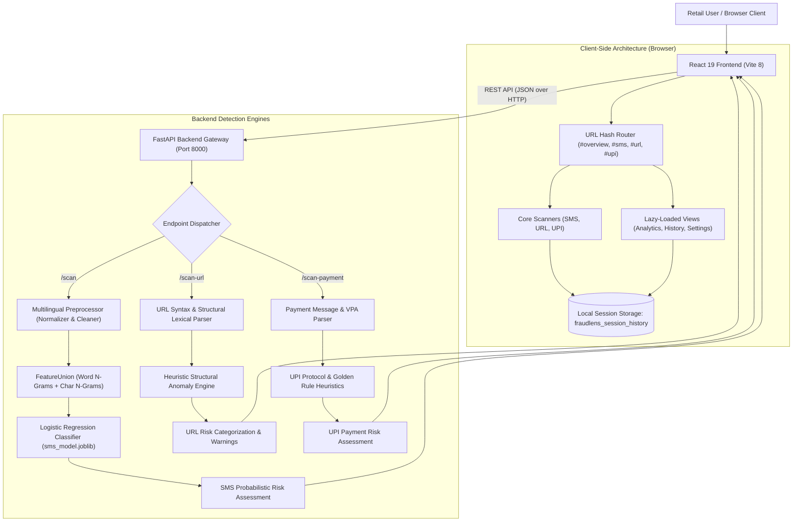

# FraudLens AI 🛡️
### Intelligent Multi-Engine Financial Fraud & Scam Defense Platform

[](https://fastapi.tiangolo.com)
[](https://react.dev)
[](https://scikit-learn.org)
[](https://www.python.org)
[](https://github.com)

FraudLens AI is an open-source, client-first financial cybercrime defense platform engineered to analyze three prevalent digital scam attack surfaces: **multilingual phishing SMS**, **malicious URL redirects**, and **deceptive Unified Payments Interface (UPI) payment traps**.

---

## 📌 Problem Statement

The rapid acceleration of instant retail digital payments in India via the Unified Payments Interface (UPI) has enabled tremendous financial inclusion, processing over 14 billion transactions monthly. However, this has been accompanied by a surge in targeted social engineering campaigns targeting retail consumers:

1. **Multilingual Phishing SMS (Smishing):** Urgent messages simulating bank account freezes, impending electricity disconnections, fake PAN/KYC suspensions, and fraudulent lottery/cashback approvals written across English, Romanized Hindi (Hinglish), and Devanagari Hindi.
2. **Deceptive & Impersonated Hyperlinks:** Phishing redirects masquerading as banking login portals utilizing Punycode homographs, deceptive subdomains (`paypal.com.verify-billing.xyz`), raw IP addresses, and embedded credentials.
3. **UPI Payment & Collect Traps:** Reverse payment deception exploiting consumer confusion regarding UPI payment authorization, specifically tricking victims into entering their UPI PIN or scanning QR codes under the false pretense of *receiving* a refund or prize.

FraudLens AI provides real-time, explainable, and privacy-preserving detection engines to counter these threats without transmitting private user financial data to third-party tracking services.

---

## 🚀 Core Features & Engine Architecture

FraudLens AI differentiates itself by clearly separating probabilistic machine learning from explainable heuristic rule engines:

### 1. Multilingual SMS Fraud Detection (Machine Learning Engine)
- **Trained Scikit-Learn Pipeline:** Features Indic-aware transliteration normalization, token cleaning, and a dual-channel `FeatureUnion` combining word n-grams (1,2) with character sub-word n-grams (3,5) fed into an unweighted L2-regularized Logistic Regression classifier ($C=10.0$).
- **Multilingual Support:** Evaluates input messages across **English**, **Hinglish** (Romanized Hindi), and **Hindi (Devanagari Unicode)**.
- **Probabilistic Risk Scoring:** Generates an explainable risk categorization (`POTENTIAL_FRAUD` vs. `NO_FRAUD_PATTERN_DETECTED`) accompanied by a continuous model confidence score (0–100%) and tailored security recommendations.

### 2. URL Phishing & Structural Analyzer (Offline Heuristic Engine)
- **100% Offline Static Analysis:** Evaluates syntactic and structural properties of target URLs without dispatching outbound HTTP requests, protecting client anonymity and preventing victim tracking.
- **Structural Anomaly Screening:** Flags IP hostnames, Punycode homoglyphs (`xn--...`), brand impersonation inside multi-level subdomains, excessive hyphenation, embedded userinfo credentials (`admin:pass@host`), open-redirect parameters, and non-standard banking ports.

### 3. UPI & Digital Payment Protection (Rule-Based Heuristic Engine)
- **UPI Golden Rule Enforcement:** Systematically flags any message or payment alert instructing the user to enter a UPI PIN or scan a QR code to *receive* funds. (Under the UPI protocol, entering a PIN or scanning a personal QR code always results in a **debit** from the user's account).
- **VPA Syntax & Keyword Verification:** Analyzes Virtual Payment Addresses (e.g., `merchant@bank`) against official PSP handles while detecting deceptive customer-care and refund keywords (`refund`, `care`, `support`, `cashback`, `nodal`) frequently used by cyber-criminals.

### 4. Interactive Threat Intelligence & Audit Logging
- **Dynamic Risk Analytics:** Real-time KPI summaries, threat distribution charts, and chronological scan timelines powered by Recharts, computed dynamically from active session scans.
- **Advanced Scan History:** Fast client-side search, multi-factor filtering (engine, threat tier, rolling date windows), sorting, and RFC 4180-compliant CSV export with UTF-8 BOM encoding for direct Microsoft Excel compatibility.
- **Diagnostic Transparency:** Real-time backend connection health monitoring, active model architecture disclosure, and local storage destruction controls.

---

## 🏛️ System Architecture



---

## 💻 Technology Stack

| Layer | Technologies & Libraries |
| :--- | :--- |
| **Backend Framework** | Python 3.12, FastAPI 0.115+, Uvicorn (ASGI) |
| **Machine Learning** | Scikit-Learn 1.6+, NumPy, Joblib |
| **Frontend Framework** | React 19, Vite 8, Lucide React Icons |
| **Data Visualization** | Recharts 3 (Area Charts, Bar Charts, Donut Graphs) |
| **Code Quality & Build**| Oxlint (Oxc), ESLint, Python Unittest |
| **Deployment Mode** | Decoupled client-server architecture with CORS isolation |

---

## 📦 Directory Structure

```
FraudLens-AI/
├── .gitignore                # Root Git ignore exclusions
├── README.md                 # Project documentation
├── run_backend.bat           # One-click Windows launcher for FastAPI backend
├── run_frontend.bat          # One-click Windows launcher for Vite frontend
├── backend/                  # Python FastAPI application
│   ├── main.py               # REST API endpoints & CORS middleware
│   ├── sms_preprocessor.py   # Indic transliteration & cleaning pipeline
│   ├── url_scanner.py        # Static URL structural heuristic analyzer
│   ├── upi_scanner.py        # UPI payment & VPA rule-based engine
│   └── requirements.txt      # Python backend dependencies
├── frontend/                 # React 19 + Vite frontend
│   ├── package.json          # Node dependencies & build scripts
│   ├── vite.config.js        # Vite build & bundle configuration
│   └── src/
│       ├── App.jsx           # Main layout, hash navigation & scanners
│       ├── App.css           # Styling & responsive design rules
│       ├── RiskAnalytics.jsx # Threat intelligence & Recharts visuals (lazy)
│       ├── AdvancedScanHistory.jsx # Search, filtering & CSV export (lazy)
│       └── SettingsDiagnostics.jsx # Telemetry, specs & privacy management (lazy)
├── models/                   # Serialized model artifacts
│   ├── sms_model.joblib      # Active frozen candidate model (Config D, C=10.0)
│   ├── sms_model_baseline.joblib # Archived baseline model
│   └── experiments/          # Candidate model experimental evaluations
├── datasets/                 # Training & evaluation datasets
│   ├── training/             # Indian SMS synthetic training corpus
│   └── evaluation/           # Locked 300-sample evaluation benchmarks
└── tests/                    # Comprehensive unit and regression test suite
```

---

## ⚙️ Installation & Setup (Windows)

### Prerequisites
- **Python:** Version 3.10, 3.11, or 3.12 installed ([python.org](https://www.python.org/downloads/)).
- **Node.js:** Version 18.x or 20.x+ installed ([nodejs.org](https://nodejs.org/)).
- **Git:** Installed and available in terminal path ([git-scm.com](https://git-scm.com/)).

### 1. Clone the Repository
```powershell
git clone https://github.com/your-username/FraudLens-AI.git
cd FraudLens-AI
```

### 2. Backend Environment Setup
Open PowerShell in the project root:
```powershell
# Create a dedicated Python virtual environment
python -m venv backend\venv

# Activate the virtual environment
.\backend\venv\Scripts\Activate.ps1

# Upgrade pip and install backend dependencies
python -m pip install --upgrade pip
pip install -r backend\requirements.txt

# Run backend unit tests to verify installation
python -m unittest discover tests
```

### 3. Frontend Environment Setup
Open a second PowerShell window or navigate to the frontend directory:
```powershell
cd frontend

# Install Node dependencies
npm install

# Verify production build compilation
npm run build
cd ..
```

---

## 🚦 Starting the Application

### Option A: One-Click Windows Launchers
For convenience, pre-configured batch scripts are provided in the repository root:
1. Double-click `run_backend.bat` to launch the FastAPI server at `http://127.0.0.1:8000`.
2. Double-click `run_frontend.bat` to launch the Vite development server at `http://localhost:5173`.

### Option B: Manual Command-Line Startup
```powershell
# Terminal 1 — Start Backend
.\backend\venv\Scripts\python.exe backend\main.py

# Terminal 2 — Start Frontend
cd frontend
npm run dev
```

Once running, navigate to `http://localhost:5173` in your web browser.

---

## 🔌 API Endpoint Documentation

The FastAPI backend exposes the following RESTful endpoints:

### 1. `GET /health`
Returns runtime engine diagnostics and model availability.
```json
{
  "status": "healthy",
  "model_loaded": true,
  "modules": {
    "sms_scanner": "TF-IDF + Logistic Regression",
    "url_scanner": "Structural Heuristic Rule-Based Engine",
    "payment_scanner": "UPI & Payment Fraud Heuristic Engine"
  },
  "version": "2.2.0"
}
```

### 2. `POST /scan`
Evaluates text messages for smishing and social engineering indicators.
- **Request Body:** `{"message": "string"}`
- **Sample Request:**
  ```json
  {
    "message": "Dear customer, your bank account is blocked due to pending KYC. Update PAN immediately at https://sbi-kyc-verify.test"
  }
  ```
- **Sample Response:**
  ```json
  {
    "prediction": 1,
    "risk_level": "POTENTIAL_FRAUD",
    "model_score": 99.54,
    "explanation": "The message exhibits language patterns and keywords strongly correlated with financial scam or phishing attempts.",
    "recommendation": "Be cautious. Do not share OTPs, PINs or passwords. Verify through official channels."
  }
  ```

### 3. `POST /scan-url`
Inspects URL syntax and structural anomalies offline without server contact.
- **Request Body:** `{"url": "string"}`
- **Sample Request:**
  ```json
  {
    "url": "https://paypal.com.verify-billing-update.xyz/login"
  }
  ```
- **Sample Response:**
  ```json
  {
    "url": "https://paypal.com.verify-billing-update.xyz/login",
    "is_valid": true,
    "risk_category": "HIGH",
    "structural_risk_score": 80,
    "is_suspicious": true,
    "warning_signs": [
      {
        "id": "subdomain_brand_spoof_paypal",
        "title": "Brand Impersonation in Subdomain ('paypal')",
        "severity": "HIGH",
        "points": 45
      }
    ],
    "warning_count": 3,
    "recommendation": "DO NOT open this link or submit any credentials.",
    "disclaimer": "Structural risk scoring is an explainable heuristic analysis of URL syntax. It does NOT make live network requests."
  }
  ```

### 4. `POST /scan-payment`
Analyzes payment alerts, collect messages, and UPI IDs (VPAs).
- **Request Body:** `{"message": "string", "upi_id": "string | null"}`
- **Sample Request:**
  ```json
  {
    "message": "Enter your UPI PIN to claim cashback of Rs 2,500 into your account.",
    "upi_id": "sbi-refund-support@ybl"
  }
  ```
- **Sample Response:**
  ```json
  {
    "is_valid": true,
    "risk_category": "HIGH",
    "structural_risk_score": 75,
    "detected_patterns": [
      "pin_to_receive_scam",
      "fake_cashback_reward"
    ],
    "recommendation": "CRITICAL WARNING: DO NOT proceed with this payment or enter your UPI PIN. Under UPI protocol, you NEVER enter a PIN to receive funds.",
    "disclaimer": "UPI fraud risk scoring is an explainable heuristic analysis. It does NOT connect to live NPCI databases."
  }
  ```

---

## 📊 Model Methodology & Synthetic Evaluation Results

### Architecture Details
- **Text Normalizer:** Custom regex token cleaner handling URL tokenization (`URL_TOKEN`), currency tokens (`CURRENCY_TOKEN`), numeric standardization, and Hindi zero-width character stripping.
- **Feature Union:** Combines Word TF-IDF ($1 \le n \le 2$, `sublinear_tf=True`) and Character n-grams ($3 \le n \le 5$, `analyzer='char_wb'`, `sublinear_tf=True`).
- **Classifier:** Logistic Regression ($C=10.0$, `class_weight=None`, `max_iter=1000`).

### Synthetic Benchmark Evaluation
The model candidate was evaluated against an independent, locked test benchmark consisting of **300 synthetic, manually authored Indian financial SMS messages** (150 scam examples, 150 legitimate banking/utility alerts) across three linguistic modalities (English, Hinglish, and Devanagari Hindi):

| Evaluation Metric | Archived Baseline Model | Frozen Production Model (`Config D, C=10.0`) |
| :--- | :---: | :---: |
| **Benchmark Sample Size** | 300 synthetic messages | 300 synthetic messages |
| **Overall Accuracy** | 50.67% (152 / 300) | **99.67% (299 / 300)\*** |
| **Scam Recall** | 9.33% (14 / 150 caught) | **100.00% (150 / 150 caught)\*** |
| **Scam Precision** | 53.85% (14 / 26) | **99.34% (150 / 151)\*** |
| **Scam F1-Score** | 15.91% | **99.67%\*** |
| **Legitimate Specificity** | 92.00% (138 / 150 clean) | **99.33% (149 / 150 clean)\*** |

> [!WARNING]
> **\*Crucial Evaluation Qualification & Disclaimer:**  
> The 99.67% accuracy and 100% scam recall figures reported above were measured **strictly on a curated synthetic benchmark of 300 manually authored messages**.  
> **These figures do NOT represent proven or guaranteed real-world accuracy.** Real-world smishing campaigns continuously evolve with novel adversarial evasion techniques, obfuscated homoglyphs, and polymorphic phrasings not present in static test sets.

---

## 🔒 Privacy & Security Commitments

1. **Client-Side Data Isolation:** Session scan history is retained exclusively inside the browser's `localStorage` (`fraudlens_session_history`). Messages and URLs are never logged to remote databases or external servers.
2. **Zero Outbound Scanning:** The URL analyzer operates entirely offline. It does not resolve DNS records, fetch remote HTML payloads, or trigger web crawlers that could alert cybercriminals.
3. **No Account Access:** The UPI engine analyzes syntax and payment semantics. It **does not connect to the National Payments Corporation of India (NPCI)**, does not verify bank balance or account ownership, and possesses zero payment processing capability.

---

## ⚠️ Known Limitations & Scope Boundaries

- **Offline Scope:** FraudLens AI cannot determine if an otherwise structurally legitimate website has been compromised on the server side (e.g., watering-hole attacks or injected scripts on trusted domains).
- **Probabilistic Boundaries:** Machine learning models are probabilistic. Legitimate messages with urgent language (e.g. valid flight cancellations) or novel scam phrasing may occasionally be misclassified.
- **Non-Authoritative:** FraudLens AI provides supplementary threat intelligence and should never replace primary verification through official banking apps, official customer care phone numbers, or multi-factor authentication.

---

## 📚 Dataset & Third-Party Attribution

- **UCI SMS Spam Collection:** Baseline comparison and 5,171 deduplicated messages in the combined multilingual training corpus utilized the academic SMS Spam Collection dataset created by **Tiago A. Almeida and José María Gómez Hidalgo** (2012; DOI: [10.24432/C5CC84](https://doi.org/10.24432/C5CC84); CC BY 4.0). This third-party dataset is utilized with full attribution to its original authors. It is not owned by FraudLens AI.
- **Indian Financial SMS Corpora:** The Indian SMS training set (`indian_sms_train.csv`, 352 train partition samples) and evaluation benchmarks (`indian_sms_final_locked.csv`, 300 locked samples) were synthetically authored by the project contributors simulating real-world cybercrime patterns without containing any real personal information, authentic telephone numbers, or private account data (governed separately under CC BY-NC 4.0).

---

## 🔮 Future Roadmap

- [ ] Mobile browser extension for on-the-fly URL checking.
- [ ] Lightweight on-device WebAssembly (Wasm) inference for client-side SMS screening.
- [ ] Expanded Indic language support covering Tamil, Telugu, Bengali, and Marathi scripts.
- [ ] Integration with open-source threat intelligence feeds (PhishTank, OpenPhish) via optional user API keys.

---

## 🖼️ Media & Previews

### Application Interface
*Dashboard and multi-scanner interfaces preview:*

```
[ Screenshot Placeholder: Overview Dashboard & Real-Time Threat Metrics ]
[ Screenshot Placeholder: Multilingual SMS Scanner with Language Presets ]
[ Screenshot Placeholder: URL Phishing Analyzer with Structural Warnings ]
[ Screenshot Placeholder: UPI Protection Engine with VPA Rule Inspection ]
[ Screenshot Placeholder: Dynamic Risk Analytics & Historical Visualizations ]
```

### Video Demonstration
*Walkthrough demonstration placeholder:*
- `[ Video Demonstration Placeholder — Link to Demo Video ]`

---

## 📄 Licensing Information

FraudLens AI adopts a dual-tier licensing and attribution framework distinguishing original software engineering from training corpora and binary model checkpoints:

1. **Original Source Code:**
   - All original project source code (FastAPI backend modules, React frontend components, test suites, and automation scripts) is licensed under the **[MIT License](LICENSE)**.
   - You are free to use, modify, distribute, and sublicense the software source code in accordance with the terms of the MIT License.

2. **Third-Party & Project Datasets (Non-MIT):**
   - The MIT License applies **strictly to original project source code and implementation files**. It does **not** apply to third-party datasets or external corpora.
   - **UCI SMS Spam Collection:** Distributed under the Creative Commons Attribution 4.0 International ([CC BY 4.0](https://creativecommons.org/licenses/by/4.0/)) licence. Authored by Tiago A. Almeida and José María Gómez Hidalgo (DOI: [10.24432/C5CC84](https://doi.org/10.24432/C5CC84)).
   - **Synthetic Indian SMS Corpora:** Authored by FraudLens AI contributors and provided under the Creative Commons Attribution-NonCommercial 4.0 International ([CC BY-NC 4.0](https://creativecommons.org/licenses/by-nc/4.0/)) licence for defensive research and academic benchmarking.
   - Complete dataset citations and licensing matrices are documented in **[`datasets/NOTICE`](datasets/NOTICE)**.

3. **Machine Learning Model Artifacts (Non-MIT):**
   - Trained model weights, vectorizer parameters, and serialized pipelines (`models/sms_model.joblib`) are compiled binary artifacts derived from training algorithms and multi-source datasets.
   - Model weights are **not automatically MIT-licensed**.
   - Because the active model was trained on a combination of CC BY 4.0 academic data (UCI SMS Spam Collection) and CC BY-NC 4.0 synthetic data, FraudLens AI **does not automatically impose CC BY-NC 4.0** on the combined binary artifact. The model's independent redistribution and commercial licensing status **requires further professional legal review**.
   - For academic evaluation, defensive cyber safety research, and personal testing, the model is provided with full dual-attribution to Almeida & Hidalgo (UCI, CC BY 4.0) and FraudLens AI contributors (synthetic Indic corpora, CC BY-NC 4.0).
   - Complete provenance, multi-source vocabulary statistics, checksums, and legal disclaimers are documented in **[`models/NOTICE.md`](models/NOTICE.md)**.
