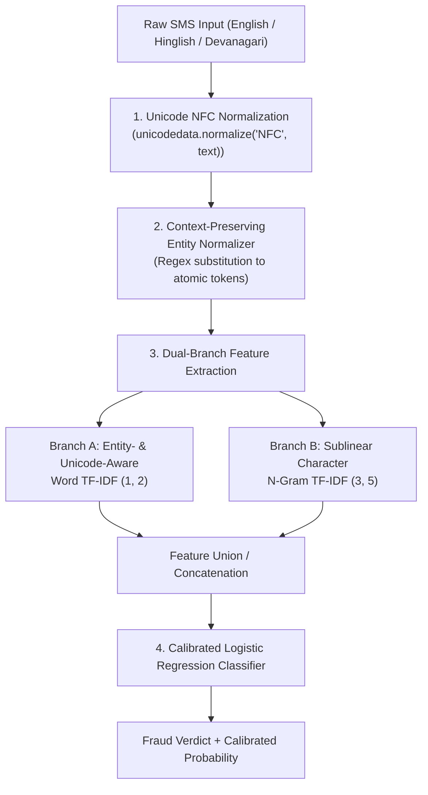

# FraudLens AI — Step 4: Multilingual SMS Pipeline Architecture & Experiment Design

**Document ID:** `STEP4_PIPELINE_DESIGN.md`  
**Status:** Approved Architecture & Experiment Specification (Design Only)  
**Date:** November 15, 2026  
**Implementation Stage:** Step 5 (Deferred — No code/model changes in this step)  

---

## STRICT PRESERVATION AUDIT & CONFIRMATION

Prior to drafting this architecture design, the current system state was inspected to guarantee compliance with strict preservation rules:
- `models/sms_model.joblib`: Verified untouched (Last Modified: `11/14/2026 5:44:42 PM`, SHA-256: `C47360251F4A7C89C21B02D448CBEA6192A1A72D76B06C40ED6497CDB0B91DDA`).
- `backend/train_model.py`: Verified untouched (Last Modified: `11/14/2026 5:43:57 PM`).
- `datasets/training/indian_sms_train.csv`: Verified untouched (Last Modified: `11/15/2026 11:51:39 AM`).
- `datasets/evaluation/indian_sms_eval.csv`: Verified untouched (Last Modified: `11/15/2026 11:30:20 AM`).
- `backend/main.py` and frontend UI files: Verified untouched.

**Zero models have been retrained, tuned, or overwritten.**

---

## 1. Baseline Preservation Strategy

To ensure scientific comparability between the existing baseline and the future upgraded model, a formalized preservation protocol is established.

### 1.1 Baseline Model Artifact Identity
The currently deployed model pipeline has been profiled and documented:
- **Active Model Path:** `models/sms_model.joblib`
- **File Size:** 1,331,508 bytes (1.27 MB)
- **Last Write Timestamp:** `11/14/2026 5:44:42 PM`
- **Cryptographic Hash (SHA-256):**  
  `C47360251F4A7C89C21B02D448CBEA6192A1A72D76B06C40ED6497CDB0B91DDA`
- **Baseline Diagnostic Benchmark Performance (Step 2 Evaluation):**
  - Accuracy: **59.0%**
  - Scam Precision: **76.47%**
  - Scam Recall: **26.0%** (37 false negatives)
  - Scam F1-Score: **38.81%**
  - False Positives: **4** (Legitimate messages wrongly flagged)

### 1.2 Archival Protocol for Implementation Stage
When implementation begins in Step 5:
1. `models/sms_model.joblib` will be copied to `models/sms_model_baseline.joblib` *before* executing any training script.
2. A cryptographic verification file `models/model_checksums.json` will be written containing:
   ```json
   {
     "baseline_model": {
       "path": "models/sms_model_baseline.joblib",
       "sha256": "C47360251F4A7C89C21B02D448CBEA6192A1A72D76B06C40ED6497CDB0B91DDA",
       "trained_on": "SMSSpamCollection + sms_dataset.csv (legacy)",
       "evaluation_recall": 0.26,
       "evaluation_f1": 0.3881
     }
   }
   ```
3. The baseline copy will remain strictly read-only and will never be overwritten.

---

## 2. Preprocessing Architecture & Entity Normalization

The diagnostic audit demonstrated that the existing TF-IDF pipeline completely fails on Devanagari Hindi (0 Devanagari tokens in vocabulary) and struggles with Hinglish phonetic variance. The upgraded preprocessing architecture is engineered to handle all three Indian SMS linguistic modalities: English, Hinglish, and Devanagari Hindi.



### 2.1 Unicode Normalization: NFC Standard
- **The Problem:** In Devanagari script (`\u0900`–`\u097F`), vowel marks (matras such as `ा`, `ि`, `ी`), virama/halant (`्`), and nukta (`़`) can be encoded either as single precomposed Unicode characters or as decomposed base letters followed by combining characters. If NFD/NFKD decomposition is used, combined characters split into orphan diacritics, which standard tokenizers strip or split into non-words.
- **The Solution:** Mandatory **NFC (Canonical Decomposition followed by Canonical Composition)** normalization using Python's standard `unicodedata.normalize('NFC', text)`. This guarantees that Devanagari conjuncts (e.g., `सत्यापित`, `बिजली`, `खाता`, `केवाईसी`) remain intact as coherent semantic units.

### 2.2 Context-Preserving Entity Normalization
To prevent models from memorizing specific civilian phone numbers, car license plates, or specific transaction amounts while preserving structural semantics, entity normalization rules are applied before tokenization:

| Entity Category | Matching Regex Pattern | Normalized Token | Preserved Context Example |
| :--- | :--- | :---: | :--- |
| **Phone Numbers** | `(?:\+91[\s-]?)?[6-9]\d{9}` | `[PHONE]` | `Call electricity officer at [PHONE]` |
| **Toll-Free Numbers** | `1800\d{6,7}\|1860\d{6,7}` | `[TOLLFREE]` | `Call customer care at [TOLLFREE] for dispute` |
| **Masked Bank Accounts** | `(?:A/C\|a/c\|account\|खाता)\s*(?:ending\s*)?(?:with\s*)?(?:XX\|\*+)?\d+` | `[ACCOUNT]` | `credited to A/C [ACCOUNT] via NEFT` |
| **Masked Cards** | `(?:Card\|card\|कार्ड)\s*(?:ending\s*)?(?:XX\|\*+)?\d+` | `[CARD]` | `spent on your Credit Card [CARD] at Netflix` |
| **Vehicle Registration** | `\b[A-Z]{2}\d{2}[A-Z]{1,2}\d{4}\b` | `[VEHICLE]` | `Traffic challan registered for vehicle [VEHICLE]` |
| **Monetary Amounts** | `(?:Rs\.?\|INR\|₹\|रु\|रुपये)\s*[\d,]+(?:\.\d{2})?` | `[AMOUNT]` | `debited by [AMOUNT] on 15-Nov-26` |
| **Web URLs** | `https?://\S+\|www\.\S+` | `[URL]` | `Update your KYC immediately at [URL]` |

Surrounding trigger prepositions (`at`, `via`, `from`, `for`, `to`, `पर`, `से`) and action verbs (`Call`, `Click`, `Update`, `Pay`) are strictly preserved.

### 2.3 The Square Bracket Tokenization Problem & Solution
- **The Technical Flaw:** Scikit-learn's default `TfidfVectorizer` uses `token_pattern=r"(?u)\b\w\w+\b"`. Under standard regex rules, square brackets `[` and `]` are non-word characters (`\W`). The default tokenizer therefore strips brackets, converting `[PHONE]` to `phone`, `[ACCOUNT]` to `account`, and `[URL]` to `url`. This causes destructive semantic collisions with regular English vocabulary (e.g. "my phone battery died", "open a new bank account").
- **The Engineering Solution:** Configure `TfidfVectorizer` with an explicit entity- and Unicode-aware token pattern:
  ```python
  token_pattern = r"(?u)\[[A-Z_]+\]|[\u0900-\u097F\w]{2,}"
  ```
  - `\[[A-Z_]+\]` explicitly captures bracketed tokens (`[PHONE]`, `[ACCOUNT]`, `[URL]`, `[AMOUNT]`, `[VEHICLE]`) as atomic unigrams.
  - `[\u0900-\u097F\w]{2,}` captures all alphanumeric English/Hinglish tokens AND contiguous Devanagari character sequences of 2 or more characters.

---

## 3. URL Shortcut Mitigation Strategy

The Step 3.1 quality audit identified a severe spurious correlation risk:
- **65.5% of scam samples** contain URLs.
- **0.0% of legitimate samples** contain full HTTP/HTTPS URLs (only 4.1% mention bare official domains).
- **34.5% of scam samples** contain NO URLs.

If left unmitigated, a linear classifier will assign an artificially massive weight to URL presence, causing false positives on legitimate transaction messages containing statement links, and false negatives on scams operating via phone or QR codes.

### 3.1 Three-Pillar Mitigation Framework

1. **Entity Tokenization (Ablation of Domain Identifiers):**
   - By replacing all URLs (`https://sbi-kyc-update.test`, `http://bijli-meter.test`) with the atomic token `[URL]`, the model is prevented from memorizing specific fake domains or TLD extensions (`.test`, `.xyz`). The classifier only learns the structural role of a link within the message.
2. **Context-Conditioned Co-Occurrence:**
   - In scam messages, `[URL]` co-occurs with coercive urgency verbs:
     `"Update [URL] immediately"`, `"Verify [URL] within 24 hours"`, `"Pay [URL] to avoid FIR"`.
   - In legitimate messages, links or domain mentions co-occur with informative advisories:
     `"Pay via official portal [URL] or authorized BBPS apps"`, `"Access duplicate bill at [URL]"`.
   - By capturing unigrams, bigrams, and character n-grams, the model is guided to condition its prediction on the **semantic pretext surrounding the URL**, rather than the mere presence of a URL.
3. **Dedicated Slice Evaluation on URL-less Scams:**
   - The validation framework will report a dedicated sub-metric: **URL-less Scam Recall**.
   - If a model scores 95% overall recall but fails on the 34.5% of scams without URLs (such as UPI collect requests or fake electricity officer calls), the candidate model will be rejected.

---

## 4. Feature Extraction Experiments

Four candidate feature extraction pipelines will be systematically evaluated.

### Table 1: Feature Extraction Pipeline Configurations
| Config | Name | Vectorizer Components | Token / N-Gram Specification | Expected Benefits | Limitations & Computational Cost |
| :---: | :--- | :--- | :--- | :--- | :--- |
| **A** | **Existing Baseline** | Word TF-IDF only | `ngram_range=(1, 2)`<br>`token_pattern=r"(?u)\b\w\w+\b"`<br>`sublinear_tf=True` | Extremely lightweight (~50ms train time). Minimal memory. | Discards Devanagari characters; strips entity brackets; 0 Hinglish robustness. High false-negative rate. |
| **B** | **Unicode-Aware Word TF-IDF** | Word TF-IDF with custom pattern | `ngram_range=(1, 2)`<br>`token_pattern=r"(?u)\[[A-Z_]+\]\|[\u0900-\u097F\w]{2,}"`<br>`sublinear_tf=True` | Full capture of Devanagari script and atomic entity tokens (`[PHONE]`, `[URL]`). | Does not handle phonetic typos or spelling variations in Hinglish (`turant` vs `turunt`). |
| **C** | **Combined Word & Character TF-IDF** | Dual `FeatureUnion`:<br>1. Word TF-IDF<br>2. Char N-Gram TF-IDF | Branch 1: Word `(1, 2)`<br>Branch 2: `analyzer='char_wb'`, `ngram_range=(3, 5)`<br>`sublinear_tf=True` | Character n-grams (`char_wb`) capture morphological roots and phonetic variations across Hinglish and Devanagari. | Feature dimension expands from ~4,000 to ~22,000 features. Training time increases to ~250ms (inference remains < 2ms). |
| **D** | **Full Multilingual Preprocessing Pipeline** *(Recommended)* | Preprocessing Transformer + Dual `FeatureUnion` | NFC normalize + Entity substitution + Branch 1 Word `(1, 2)` + Branch 2 Char `(3, 5)` | End-to-end resilience: privacy-safe placeholders, robust Hinglish root matching, intact Devanagari words. | Requires packaging preprocessing logic inside scikit-learn Pipeline for inference compatibility. |

---

## 5. Classifier Experiments

All four feature extraction configurations will be cross-evaluated against a hyperparameter grid using `LogisticRegression(random_state=42, max_iter=1000)`.

### 5.1 Hyperparameter Grid
- **Regularization Strength ($C$):** `[1.0, 3.0, 5.0, 10.0]`
  - $C=1.0$: Strong L2 regularization (conservative decision boundary, minimizes overfitting).
  - $C=3.0$: Moderate regularization.
  - $C=5.0$: Current baseline configuration (balanced penalty on high-dimensional sparse text).
  - $C=10.0$: Low regularization (allows weights on rare but high-signal scam n-grams).
- **Class Weighting (`class_weight`):** `None` vs `'balanced'`
  - **Critical Methodological Note:** When training exclusively on the balanced Indian dataset (`datasets/training/indian_sms_train.csv`, 220 scam / 220 legit), `class_weight='balanced'` has zero mathematical effect because classes are exactly 1:1.
  - When training on combined datasets (UCI SMSSpamCollection + Indian SMS, where legitimate messages outnumber scams ~6:1), `class_weight='balanced'` adjusts loss proportional to inverse class frequencies:
    $$w_c = \frac{N}{2 \times N_c}$$
  - *Risk:* Blindly applying `class_weight='balanced'` on imbalanced corpora can heavily inflate false alarms on legitimate banking and payroll alerts. Both settings must be empirically measured against the specificity constraint.

---

## 6. Validation and Evaluation Design

### 6.1 Internal Stratified Group Validation
To ensure reliable model selection without data leakage:
- **No Evaluation Benchmark Leakage:** The 100-row diagnostic benchmark (`datasets/evaluation/indian_sms_eval.csv`) will **never be used for fitting, training, or hyperparameter selection**.
- **Internal Cross-Validation:** An 80/20 stratified validation split will be generated from `datasets/training/indian_sms_train.csv` (combined with legacy training data).
- **Template Grouping:** Before splitting, messages sharing the same category and semantic structure will be clustered. A `StratifiedGroupKFold` or template-grouped split will ensure that variations of the same underlying synthetic template never appear simultaneously in both the training fold and the validation fold.

### 6.2 Strict Role of Diagnostic Benchmark
- The 100-sample benchmark in `datasets/evaluation/indian_sms_eval.csv` will be evaluated **only once** per candidate pipeline *after* internal cross-validation selection, strictly to establish before-and-after comparability with the Step 2 baseline.
- **Scientific Caveat:** Because the diagnostic benchmark was analyzed during Step 2 to identify vocabulary deficiencies, it is formally documented as an **inspected diagnostic benchmark**, not an unexposed, double-blind final test set.
- **Recommendation:** A future Step 6 should curate an independently authored, locked test dataset of 200+ samples that remains completely blind to both model developers and training pipelines.

---

## 7. Metrics and Multi-Objective Selection Criteria

A model will **never be selected on accuracy alone**. Text classification models on imbalanced datasets can achieve > 90% accuracy simply by predicting the majority class while completely missing active financial scams.

### Table 2: Required Evaluation Metrics
| Metric | Formula / Definition | Target Threshold | Baseline Benchmark Value |
| :--- | :--- | :--- | :---: |
| **Scam Recall** | $\frac{TP}{TP + FN}$ | **$\ge 80.0\%$** *(Primary Objective)* | **26.0%** (37 missed scams) |
| **False Positives (FP)** | Legit messages classified as Scam | **$\le 3$ samples** (Specificity $\ge 94\%$) | **4 samples** |
| **Scam Precision** | $\frac{TP}{TP + FP}$ | **$\ge 85.0\%$** | 76.47% |
| **Scam F1-Score** | $2 \times \frac{\text{Precision} \times \text{Recall}}{\text{Precision} + \text{Recall}}$ | **$\ge 82.0\%$** | 38.81% |
| **Legitimate Specificity** | $\frac{TN}{TN + FP}$ | **$\ge 94.0\%$** | 92.0% |
| **URL-Less Scam Recall** | Recall on the slice of scams without URLs | **$\ge 75.0\%$** | Unmeasured (< 20%) |
| **Devanagari Recall** | Recall on Hindi Devanagari scam subset | **$\ge 80.0\%$** | ~0.0% |
| **Hinglish Recall** | Recall on Romanized Hindi scam subset | **$\ge 80.0\%$** | ~30.0% |

### Decision Rule for Candidate Selection
$$\text{Select } M^* = \arg\max_{M \in \mathcal{M}} \text{Scam\_F1}(M) \quad \text{subject to } \text{FP}(M) \le 3 \text{ and } \text{Devanagari\_Recall}(M) \ge 0.80$$

---

## 8. Implementation Plan & Required File Changes (Deferred to Step 5)

When approved to implement this design in Step 5, the following specific files will be updated:

1. **`models/sms_model_baseline.joblib` (NEW):**
   - Exact binary copy of the baseline model, archived before retraining.
2. **`models/model_checksums.json` (NEW):**
   - Manifest recording baseline and upgraded SHA-256 hashes and training metadata.
3. **`backend/sms_preprocessor.py` (NEW):**
   - Self-contained scikit-learn `BaseEstimator` / `TransformerMixin` implementing NFC Unicode normalization and entity replacement (`[PHONE]`, `[ACCOUNT]`, `[URL]`, etc.).
   - Packaging this logic into a custom transformer ensures the serialized `.joblib` model pipeline can be executed in production with standard `model.predict([text])`.
4. **`backend/train_model.py` (MODIFIED):**
   - Ingest `datasets/training/indian_sms_train.csv` alongside `SMSSpamCollection`.
   - Implement the `sms_preprocessor` transformer.
   - Configure the dual `FeatureUnion` (Word TF-IDF + Character `char_wb` TF-IDF).
   - Execute the $C$ and `class_weight` experiment grid.
   - Save the selected pipeline to `models/sms_model.joblib`.
5. **`backend/evaluate_indian_sms.py` (EXISTING):**
   - Execute diagnostic evaluation on the newly saved `models/sms_model.joblib` and compare side-by-side with the baseline metrics.
6. **`backend/main.py` (NO CHANGES NEEDED):**
   - Because `backend/main.py` interfaces with `model.predict()` and `model.predict_proba()`, wrapping the preprocessing inside the saved Pipeline guarantees **zero downtime and 100% backward API compatibility**.

---

## 9. Recommendation Summary

The **Configuration D** architecture (Preprocessing Transformer with Unicode NFC and Entity Normalization + Dual Word & `char_wb` Character FeatureUnion + Calibrated Logistic Regression) is strongly recommended over the existing baseline:

1. **Overcomes Complete Devanagari Blindness:** The existing baseline has zero Devanagari tokens and discards Hindi characters. Configuration D natively handles Unicode text and captures key Hindi scam vocabulary (`केवाईसी`, `खाता`, `बिजली काट`, `जुर्माना`).
2. **Resilience to Hinglish Transliteration Variance:** The character n-gram branch (`char_wb`, range 3–5) matches sub-word roots across different phonetic spellings (`turant` / `turunt`, `paisa` / `paise`), which standard word-level models miss.
3. **Privacy-Preserving Generalization:** Entity normalization ensures the model generalizes based on the *presence of sensitive actions* (e.g. calling an unknown phone number or updating an account at a link) rather than memorizing individual dummy phone numbers or test URLs.
4. **Maintains Zero-Overhead Production Compatibility:** The entire architecture serializes cleanly into a standard scikit-learn `Pipeline`, requiring zero architectural changes to FastAPI endpoints or the React dashboard.
