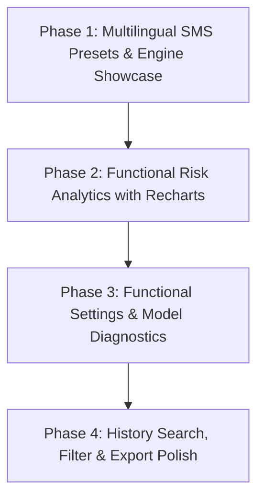

# FraudLens AI — Step 8A: Comprehensive Frontend UX & Feature Audit

**Document ID:** `STEP8A_UX_AUDIT.md`  
**Audit Date:** 2026-11-17  
**Audit Scope:** Full React Frontend Codebase (`App.jsx`, `App.css`, `index.html`, package dependencies, layouts, and UX workflows)  
**Audit Paradigm:** Strictly Read-Only Architecture & Usability Evaluation  

---

## 1. Executive Summary

A comprehensive, read-only architectural, functional, and usability audit of the FraudLens AI React frontend was conducted. 

The frontend presents a clean, modern fintech aesthetic inspired by enterprise security dashboards (Stripe/Linear style: Slate, Deep Navy, Royal Blue, and Purple accents). It successfully provides functional user interfaces for all three active detection engines: **SMS Scam Detection**, **URL Phishing Scanner**, and **UPI Payment Fraud Defense**.

However, the audit identified significant functional gaps, incomplete placeholder pages, routing limitations, and opportunities for demo-readiness:
1. **Unfinished Modules:** Both **Risk Analytics** (`analytics`) and **Settings** (`settings`) are currently static **"COMING SOON · v2.3"** placeholder cards with dead-end links, despite `recharts` being installed in `package.json`.
2. **State-Only Navigation:** Routing is implemented via local React `useState` rather than `react-router-dom` (which is installed in `package.json` but unused), causing full loss of tab state on page refresh and disabling browser back/forward buttons.
3. **Multilingual Disconnect in SMS UI:** The newly deployed Step 7 multilingual SMS model natively supports English, Hinglish, and Hindi (Devanagari), but the UI sample test pills exclusively feature English messages.
4. **Mobile Navigation Constraints:** On small mobile screens (<600px), the sidebar collapses into a cramped horizontal icon scroll without text labels or a mobile navigation drawer.
5. **No Data Export or Session Persistence Controls:** While history persists to `localStorage`, users cannot export reports (CSV/JSON), filter by engine type, or search historical scans.

---

## 2. Existing Functionality Audit

### 2.1 Navigation & Global Shell
- **Brand Identity:** High-fidelity sidebar header with gradient shield logo (`ShieldCheck`), clear hierarchy ("FraudLens AI — FINANCIAL SECURITY"), and version indicators (`v2.2.0`).
- **Sidebar Navigation:** 7 defined navigation items with Lucide icons (`LayoutDashboard`, `MessageSquareText`, `Link2`, `Smartphone`, `Activity`, `History`, `Settings`).
- **Live Health Polling:** Interactive backend health monitor in the sidebar footer that polls `GET /health`, displays connection status with pulsating status dots (green for online, amber for offline), lists engine architectures, and provides a manual refresh trigger.
- **Dynamic Topbar:** Breadcrumb path matching active view, model engine pill updating dynamically per tab, and backend status badge.

### 2.2 Overview Dashboard (`overview` tab)
- **Hero Section:** Clear value proposition, quick-launch navigation buttons for all three scanners and scan history.
- **Dynamic Metric Cards:** 4 real-time cards (Session Scans, High Risk Flagged, Clean / Low Risk, Average Risk Rating) derived strictly from actual session activity without hardcoded fake metrics.
- **Quick Security Scanner:** Embedded quick-scan card allowing users to test SMS samples directly from the dashboard.
- **Threat Coverage Reference:** Explanatory threat cards outlining UPI collect traps, phishing domains, KYC deactivations, and OTP theft.
- **Recent Activity Table:** Live tabular feed of the last 6 session scans displaying type pill, timestamp, message preview, risk badge, score, and an interactive "Inspect" button.

### 2.3 SMS Scam Detection Interface (`sms` tab)
- **Quick Test Dataset Samples:** 4 interactive sample pills (KYC Account Block Phishing, Fake Lottery Prize, Salary Credit, Monthly Utility Bill).
- **Interactive Form:** Multi-line textarea with real-time character and word count indicators, "Clear text" shortcut, and loading state with spinner.
- **Explainable Result Display:**
  - High-visibility banner with dual risk badges (`POTENTIAL FRAUD DETECTED` in red / `NO FRAUD PATTERN DETECTED` in green).
  - Scaled risk meter bar with percentage display.
  - Distinct panels for "Model Explanation" and "Recommended Action".
  - Expandable developer drawer to inspect raw JSON payloads from FastAPI.

### 2.4 URL Phishing Scanner Interface (`url` tab)
- **Interactive Form:** Single-line URL input with globe icon and clear button.
- **Sample Presets:** 5 structural phishing presets (Subdomain Brand Spoof, Direct IP Host, Punycode Homograph, URL Shortener, Legitimate HTTPS).
- **Granular Syntactic Breakdown:**
  - Tri-level risk taxonomy: `HIGH STRUCTURAL RISK`, `MEDIUM STRUCTURAL RISK`, `LOW STRUCTURAL RISK`.
  - Heuristic score meter (0–100 scale).
  - Detected warning sign cards highlighting specific rule violations with severity tags (`HIGH`, `MEDIUM`, `LOW`) and point contributions (e.g. `+40 pts`).
  - Extracted structural components pill grid displaying scheme, hostname, root domain, subdomains, port, IP host flag, shortener flag, and punycode flag.
  - Security recommendations and static verification disclaimers.

### 2.5 UPI Payment Protection Interface (`upi` tab)
- **Interactive Form:** Dual-input interface accepting both transaction notification text and target UPI ID / VPA.
- **Sample Presets:** 7 real-world Indian fraud cases (PIN to Receive Cashback, Scan QR to Receive, Collect Request Trap, Fake Accidental Refund, Suspicious VPA, HDFC Debit Alert, SBI Credit Notification).
- **VPA Format & Keyword Evaluation:** Specific cards analyzing handle validity (`@okhdfcbank`, `@ybl`) and flagging deceptive service keywords (`refund`, `support`, `care`).
- **Educational Callout:** Dedicated NPCI UPI Safety Golden Rules card outlining the 3 golden rules (PIN is never for receiving, QR codes are for sending only, verify balance inside bank app).

### 2.6 Scan History Interface (`history` tab)
- **Persistent Log:** Automatically persists every scan (SMS, URL, UPI) to browser `localStorage` under `fraudlens_session_history`.
- **Chronological Feed:** Cards showing timestamp, date, scan type pill, quoted content, score, and risk badge.
- **Re-inspect Integration:** Clicking "Re-inspect in Scanner" pre-populates the corresponding scanner tab and automatically renders the detailed breakdown.
- **Clear History:** Confirmation dialog allowing users to wipe session history.

---

## 3. Incomplete Functionality & Placeholder Modules

### 3.1 Risk Analytics Page (`analytics` tab) — Incomplete Placeholder
- **Current Implementation:** A static "COMING SOON · v2.3" banner card with dead-end secondary buttons.
- **Missing Architecture:**
  - `recharts` is already installed in `frontend/package.json` (`^3.10.1`), but **zero chart components are implemented**.
  - No trend analysis over time (scans per hour/day).
  - No visual threat distribution pie/donut chart (SMS vs URL vs UPI).
  - No severity distribution bar chart (High Risk vs Medium vs Low).
  - No top flagged keywords or deceptive VPA handle aggregations.

### 3.2 Settings Page (`settings` tab) — Incomplete Placeholder
- **Current Implementation:** A static "COMING SOON · v2.3" card identical to Analytics.
- **Missing Architecture:**
  - **API Endpoint Configuration:** Backend URL is hardcoded to `VITE_API_URL || http://127.0.0.1:8000`. Users cannot configure or test custom backend hostnames in the UI.
  - **Sensitivity / Threshold Controls:** No user-adjustable risk threshold slider (e.g., alert at >50% vs >70% confidence).
  - **Storage Management:** No button to view storage usage, export history, or reset application defaults.
  - **Active Model Diagnostics:** No system information card displaying active model hashes, installed version, pipeline steps, or engine status.

---

## 4. Usability Problems, Bugs & UI Inconsistencies

### 4.1 Missing Multilingual SMS Showcase
- **Problem:** Step 7 successfully integrated a trilingual model covering English, Hinglish, and Hindi (Devanagari). However, `SAMPLE_MESSAGES` in `App.jsx` only contains 4 English samples.
- **Impact:** Reviewers and demo evaluators clicking sample pills cannot test or observe Hinglish or Devanagari detection without manually typing or finding external samples.

### 4.2 State-Only Navigation (No URL Routing)
- **Problem:** Navigation relies exclusively on React local state: `const [activeTab, setActiveTab] = useState('overview')`.
- **Impact:**
  - Hitting browser Refresh (`F5`) always resets the view back to `overview`, losing the user's active scan view.
  - Browser Back and Forward buttons do not work between tabs.
  - Users cannot bookmark or share links to specific tabs (e.g. `/url` or `/upi`).
  - `react-router-dom` is already installed in `package.json` (`^7.18.5`) but completely unused.

### 4.3 Mobile Viewport Degeneracy (<600px)
- **Problem:** In `App.css` lines 1608–1636, when screen width is under 600px, `.fintech-sidebar` becomes `flex-direction: row; overflow-x: auto;`.
- **Impact:**
  - Navigation icons scroll horizontally in a narrow, unlabelled bar at the top of the viewport.
  - The health card and brand subtitle disappear completely.
  - The active tab indicator is obscured.
  - On mobile devices, this feels awkward compared to a standard mobile bottom navigation bar or slide-out drawer.

### 4.4 History Tab Lacks Filtering and Search
- **Problem:** As history grows, all scans are displayed as an unpaginated, unfilterable list.
- **Impact:** Users cannot filter by scan type (`SMS`, `URL`, `UPI`) or risk level (`High Risk`, `Clean`), nor search by message keywords or domains.

### 4.5 Accessibility & Visual Details
- **Icon-Only Buttons:** The health refresh button and clear buttons lack explicit `aria-label` tags.
- **Raw JSON Inspection:** The `<pre>` JSON blocks lack syntax highlighting or a "Copy JSON" button.
- **Sample Selection Reset:** Clicking sample pills resets any previously displayed scan result, forcing the user to manually click "Analyze" again.

---

## 5. Prioritized Improvement Plan

### Priority 1: High Impact (Core Demo-Readiness)
1. **Multilingual SMS Sample Pills:** Add realistic Hinglish and Devanagari test samples to `SAMPLE_MESSAGES` (e.g. Electricity cutoff in Hinglish, SBI account block in Devanagari, legitimate pension credit in Devanagari).
2. **Implement Functional Risk Analytics Tab:**
   - Leverage installed `recharts` library to render:
     - Scan Volume Breakdown (Pie / Donut chart: SMS vs URL vs UPI).
     - Risk Severity Distribution (Bar chart: High Risk vs Clean).
     - Confidence Score Histogram or Trend timeline.
   - Display summary metric tiles (Detection Rate, Threat Velocity, Clean Rate).
   - Render graceful empty states when session history is low.
3. **Implement Functional Settings Tab:**
   - Active Model Information card: Display model version, SHA-256 hash preview, pipeline stages, and classes.
   - Backend API URL configuration input (allows custom port or remote host testing).
   - Risk Threshold Sensitivity slider (adjust display threshold between Conservative and Aggressive).
   - Cache & History management (Export history as JSON, Clear cache button).

### Priority 2: Medium Impact (Usability & Workflow Polish)
4. **History Filters & Search:** Add search bar and filter chips (`All`, `SMS`, `URL`, `UPI`, `High Risk`) to the Scan History page.
5. **JSON Copy Button:** Add a quick "Copy to Clipboard" button inside the raw JSON payload viewer on all three scanners.
6. **Toast Feedback:** Add lightweight visual confirmation toasts (e.g., "Copied to clipboard", "History cleared", "Backend reconnected").

### Priority 3: Polish & Refinement (Future Enhancements)
7. **URL Routing Integration:** Adopt `react-router-dom` or hash-based routing (`#/sms`, `#/url`, `#/upi`, `#/analytics`) so tabs persist across refreshes.
8. **Mobile Navigation Drawer:** Replace horizontal icon scrolling with a modern slide-over menu or bottom navigation bar on mobile viewports.
9. **Dark Mode Support:** Implement a dark mode toggle utilizing existing CSS variables.

---

## 6. Recommended Implementation Order for Step 8B

To ensure zero backend disruption, high visual polish, and rapid execution, the following 4-phase sequence is recommended for Step 8B:

1. **Phase 1: Multilingual Showcase & Engine Telemetry**
   - Update `SAMPLE_MESSAGES` with Hinglish and Devanagari examples.
   - Update model descriptions to highlight verified trilingual support.
2. **Phase 2: Risk Analytics Implementation**
   - Replace placeholder card with real `recharts` visualizations (Donut chart of scan types, Bar chart of threat levels, Average score gauge).
   - Provide interactive sample data toggle if session history is empty so demos look vibrant immediately.
3. **Phase 3: Settings & Diagnostics Implementation**
   - Replace placeholder card with live system diagnostics (SHA-256 signatures, active model metadata).
   - Add threshold sensitivity controls and export tools.
4. **Phase 4: History Search, Filter & Mobile Polish**
   - Add search and category filter pills to the history tab.
   - Improve responsive styling for tablet and mobile viewports.

---

## 7. Preservation Confirmation

This audit was conducted strictly in read-only mode. Zero backend code, machine learning pipelines, dataset files, or API endpoints were altered.
